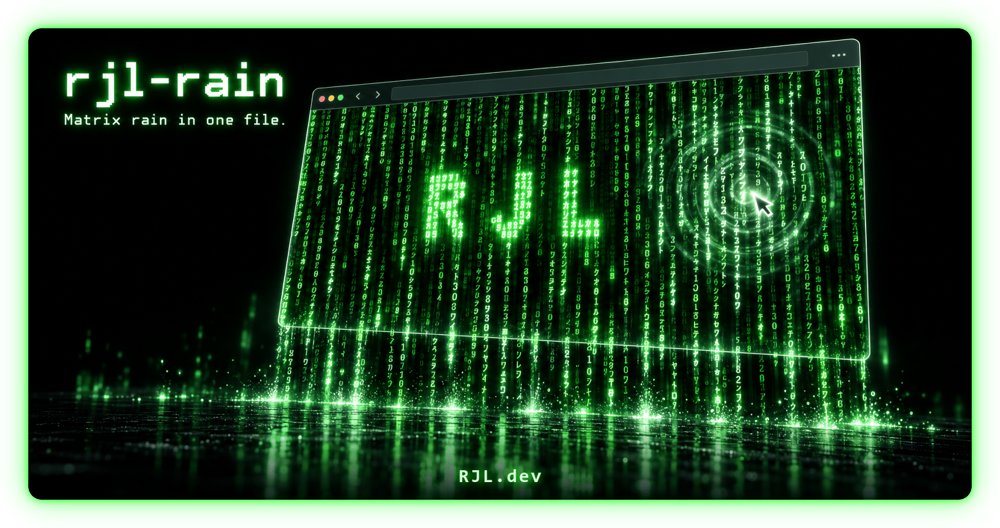

<a href="https://rjl.sh/"></a>

<p align="center">
  <a href="https://www.npmjs.com/package/rjl-rain"></a>
  <a href="https://github.com/rjlsoftware/rjl-rain/blob/main/LICENSE"></a>
  
  
  
  <a href="https://github.com/rjlsoftware/rjl-rain/actions/workflows/ci.yml"></a>
  <a href="https://rjlsoftware.github.io/rjl-rain/playground/"></a>
</p>

# rjl-rain

**Matrix digital rain in one file.** Drop it on a page and the page rains: a canvas, zero
dependencies, 5.6 KB gzipped.

<p align="center">
  <a href="https://rjlsoftware.github.io/rjl-rain/playground/"></a>
</p>

It started life as the background of [RJL OS](https://rjl.sh), a fake operating system on a
single web page, and it keeps everything that made it fun there:

- **Touch the rain.** Glyphs brighten around the pointer and fall faster under it. Click and a
  ripple rolls out through the drops.
- **A hidden word.** Every so often the falling drops spell a word (`RJL` by default) in bright
  ones, then wash it away. Give it a list and it spells them in turn, or call
  `rain.form('HELLO')` to spell one on demand.
- **Anywhere.** Full-screen behind the page, inside any element (a hero, a card, a footer), or
  over a photo or video with a transparent background. No JavaScript needed: `<rjl-rain>` works on
  its own.
- **Respectful.** With `prefers-reduced-motion` it paints one still frame and never animates, and
  it switches live if the setting changes. An optional pause button covers WCAG 2.2.2. The canvas
  is `aria-hidden` and ignores the pointer, so the page under it works as normal.
- **Cheap.** One `requestAnimationFrame` loop at a deliberate 20 fps retro cadence, nothing at all
  in a hidden tab or while the rain is scrolled out of view. Crisp on high-DPI screens.

<p align="center">
  
</p>

**[Try every option in the playground](https://rjlsoftware.github.io/rjl-rain/playground/)** and copy
the code it writes, or see it live at **[rjl.sh](https://rjl.sh)** - move the mouse, click, and wait
for the word.

## Quick start

Full-screen rain behind your page, from a CDN:

```html
<script src="https://cdn.jsdelivr.net/gh/rjlsoftware/rjl-rain@v1.1.1/rjl-rain.min.js" integrity="sha384-cKYiCuuY2ponzl1oN9S28Tak9x0P1KH5IkkltzEmRCFSidDC0ISQXuAc0PyhqKy5" crossorigin="anonymous"></script>
<script>RJLRain();</script>
```

That is the whole install. `RJLRain()` with no target creates a fixed, full-viewport canvas behind
everything else on the page (it waits for `<body>` if you call it from `<head>`). jsDelivr serves the
file straight from the release tag, and the `integrity` hash makes the browser refuse any other
bytes. The npm package is on unpkg too: `https://unpkg.com/rjl-rain@1.1.1/rjl-rain.min.js`.

**No JavaScript at all:** load the script, then put the rain where you want it:

```html
<rjl-rain word="HELLO" color="#FFB000" style="height: 320px"></rjl-rain>
<rjl-rain fullscreen></rjl-rain>  <!-- or behind the whole page -->
```

**npm:**

```bash
npm install rjl-rain
# or straight from GitHub:
npm install github:rjlsoftware/rjl-rain#v1.1.1
```

```js
import RJLRain from 'rjl-rain';   // or: const RJLRain = require('rjl-rain');
RJLRain();
```

**ES module from a CDN**, no build step:

```html
<script type="module">
  import RJLRain from 'https://cdn.jsdelivr.net/gh/rjlsoftware/rjl-rain@v1.1.1/rjl-rain.min.mjs';
  RJLRain();
</script>
```

**Self-hosted:** copy `rjl-rain.min.js` (or the readable `rjl-rain.js`, or the `.mjs` modules) from
this repository or from the files attached to each
[release](https://github.com/rjlsoftware/rjl-rain/releases), and point the `<script>` at your copy.

`rjl-rain.js` is UMD: a classic `<script>` gets `window.RJLRain`, and CommonJS gets the same
function as the module export. `import` resolves to `rjl-rain.mjs`, and TypeScript types ship for
both.

## Inside an element

Pass an element (or a selector for one) and the rain fills it, behind its content:

```html
<section id="hero" style="height: 420px">
  <h1>Welcome</h1>
</section>
<script>RJLRain('#hero', { word: 'WELCOME' });</script>
```

RJLRain adds a canvas as the element's first child, makes the element `position: relative` and
`isolation: isolate` if it was not already, and puts both back on `destroy()`. It follows the
element's size as the layout changes.

**Your own canvas:** give it a `<canvas>` sized with CSS and it draws on that instead:

```html
<canvas id="screen" style="width: 100%; height: 320px"></canvas>
<script>RJLRain('#screen', { chars: 'RJL', color: '#FFB000', bright: '#FFE2A8' });</script>
```

## Rain over anything

`background: 'transparent'` lets whatever is behind the canvas show through: a photo, a video, a
gradient.

```html
<section id="hero" style="height: 420px; background: url(city.png) center / cover">
  <h1>Night shift</h1>
</section>
<script>RJLRain('#hero', { background: 'transparent', fade: 0.08 });</script>
```

A fade can only shrink a pixel's alpha, so every trail would leave a faint tint behind; rjl-rain
clears that tail away, one band of the canvas per frame, so the canvas stays truly clear between
the drops.

## Make it yours

<p align="center">
  
</p>

Any palette, any glyphs, any words, and every option can change live with `rain.set()`. For the
film's look, give each drop a white-hot leader and let the columns fall at their own speeds:

```js
RJLRain({ head: '#E8FFE8', speedVariance: 0.6 });
```

Spell several words in turn, centered, and react to each one:

```js
RJLRain({
  word: ['WAKE UP', 'FOLLOW', 'THE RAIN'],
  wordPosition: 'center',
  onWord: (word) => console.log('the rain spelled', word)
});
```

## No JavaScript: `<rjl-rain>` and `data-rjl-rain`

Loading the script defines a `<rjl-rain>` element. Its attributes are the options in kebab-case
(`font-size`, `speed-variance`, `word-position`...), `word` takes a comma-separated list, `chars`
takes a preset name (`classic`, `rjl`, `binary`, `hex`) or any glyphs, and changing an attribute
updates the rain live. `fullscreen` puts the rain behind the whole page. It fires a `word` event
each time a word forms, and its controller is `element.rain`.

```html
<rjl-rain chars="binary" word="HELLO, WORLD" word-position="center" head="#FFFFFF" controls
          style="height: 50vh"></rjl-rain>
```

Or start any element from a `data-rjl-rain` attribute holding the options as JSON (or nothing):

```html
<div data-rjl-rain='{"word": "HELLO", "color": "#9BD4FF"}' style="height: 300px"></div>
<canvas data-rjl-rain style="width: 100%; height: 200px"></canvas>
<body data-rjl-rain>  <!-- full-screen -->
```

Elements present when the page loads start by themselves; call `RJLRain.auto()` after adding more.
Each one's controller is `element.rjlRain`.

## Frameworks

Import it anywhere: nothing touches the DOM until you call it, so server rendering is safe. Start
it once the element exists and destroy it when the component goes away.

**React** (in Next.js, a `'use client'` component):

```jsx
import { useEffect, useRef } from 'react';
import RJLRain from 'rjl-rain';

export function Hero() {
  const ref = useRef(null);
  useEffect(() => {
    const rain = RJLRain(ref.current, { word: 'HELLO' });
    return () => rain.destroy();
  }, []);
  return <section ref={ref} style={{ height: 420 }}><h1>Hello</h1></section>;
}
```

**Vue:**

```vue
<script setup>
import { onMounted, onBeforeUnmount, ref } from 'vue';
import RJLRain from 'rjl-rain';

const hero = ref(null);
let rain;
onMounted(() => { rain = RJLRain(hero.value, { word: 'HELLO' }); });
onBeforeUnmount(() => rain.destroy());
</script>

<template><section ref="hero" style="height: 420px"><h1>Hello</h1></section></template>
```

**Svelte** (an action, so options stay live):

```svelte
<script>
  import RJLRain from 'rjl-rain';
  function rain(node, options) {
    const r = RJLRain(node, options);
    return { update: (next) => r.set(next), destroy: () => r.destroy() };
  }
</script>

<section use:rain={{ word: 'HELLO' }} style="height: 420px"><h1>Hello</h1></section>
```

**Astro**, or any site with a build step:

```astro
<section id="hero" style="height: 420px"><h1>Hello</h1></section>
<script>
  import RJLRain from 'rjl-rain';
  RJLRain('#hero', { word: 'HELLO' });
</script>
```

Or skip the wiring: `import 'rjl-rain'` once, then use `<rjl-rain>` in any template.

## Accessibility

- **Reduced motion.** With `prefers-reduced-motion: reduce` it paints one still frame and never
  animates; `reducedMotion: true` or `false` overrides the visitor's setting.
- **A pause button.** WCAG 2.2.2 asks for a way to pause motion that runs for more than five
  seconds next to other content. `controls: true` adds a small round button in the corner (an
  `aria-pressed` toggle labeled "Pause animation"); `controls: '#my-button'` turns a button of your
  own into one. A visitor's choice is remembered in `localStorage` (`rjl-rain:paused`), so the rain
  stays paused on their next page.
- **Out of the way.** The canvas is `aria-hidden` and `pointer-events: none`, and clicks on links,
  buttons and form fields never make ripples.

## Options

Every option is optional.

| Option | Default | What it does |
|---|---|---|
| `chars` | half-width katakana + digits | The glyphs that rain. Any string, or a preset from `RJLRain.glyphs`: `classic`, `rjl`, `binary`, `hex`. |
| `color` | `'#00FF00'` | The rain. |
| `bright` | `'#B6FFB6'` | The pointer glow, the ripples and the word. |
| `head` | `''` | The leading glyph of every drop. `''` keeps it the rain color. |
| `background` | `'#000000'` | The color the trails fade into, or `'transparent'` to rain over whatever is behind the canvas. |
| `fade` | `0.05` | How much each frame darkens the last, from 0 to 1. Lower means longer trails. |
| `fontSize` | `16` | Glyph size in px, which is also the column width. |
| `fontFamily` | `'monospace'` | Any CSS font family list. A web font is requested for you. |
| `fps` | `20` | Frames per second, 1 to 60. |
| `speed` | `1` | Rows a drop falls per frame, 0.1 to 3. |
| `speedVariance` | `0` | 0 to 1: how much slower than `speed` each column may fall. |
| `word` | `'RJL'` | The word the drops spell now and then, or an array spelled in turn. `''` turns it off. Letters, digits and `! ? . - : _ '`. |
| `wordChance` | `0.005` | Chance per frame that a new word starts. |
| `wordFrames` | `50` | How many frames a word lasts. |
| `wordChar` | `'1'` | The glyph the word is drawn with. |
| `wordScale` | `1` | Cells per letter pixel. `2` doubles the word's size. |
| `wordPosition` | `'random'` | `'random'` or `'center'`. |
| `onWord` | `null` | Called with the word each time one forms. |
| `interactive` | `true` | Pointer glow and click ripples. |
| `glowRadius` | `70` | Radius of the pointer glow in px. |
| `ignore` | links, buttons, form fields | A CSS selector. Clicks on matching elements make no ripple. |
| `reducedMotion` | `'auto'` | `'auto'` follows the visitor's setting, `true` always paints one still frame, `false` always animates. |
| `pauseOffscreen` | `true` | Stop drawing while the canvas is scrolled out of view. |
| `controls` | `false` | `true` adds a pause button; a selector or element turns a button of your own into one. |

## API

`RJLRain(target?, options?)` returns a controller. `target` is an element or a selector for one (the
rain fills it), a `<canvas>` (it draws on it), or nothing (full-screen).

| Member | What it does |
|---|---|
| `form(word?)` | Spells `word` (default: the next `word` option) now. Returns `false` if it does not fit. |
| `pause()` / `resume()` | Stops and restarts the animation loop. |
| `set(options)` | Changes any options live, for example `rain.set({ color: '#9BD4FF' })`. |
| `resize()` | Re-measures the canvas. Rarely needed: size changes are picked up automatically. |
| `destroy()` | Stops everything, removes every listener, and removes the canvas if RJLRain created it. |
| `running` | Whether the loop is running (false while paused, off-screen or in reduced motion). |
| `paused` | Whether it was paused, by `pause()` or by the pause button. |
| `forming` | Whether a word is showing. |
| `canvas` | The canvas being drawn on. |

Also on the function: `RJLRain.version`, `RJLRain.defaults`, `RJLRain.glyphs`,
`RJLRain.wordShape(word, scale)` (the cells a word lights up) and `RJLRain.auto(root?)` (starts new
`data-rjl-rain` elements).

**TypeScript:** types ship in the package (`rjl-rain.d.ts`, and `rjl-rain.d.mts` for `import`), with
`RJLRain.Options`, `RJLRain.Controller` and a typed `<rjl-rain>` element.

## Notes

- **Backgrounds.** The full-screen canvas sits at `z-index: -1`. If both `<html>` and `<body>` set a
  background color, the `<body>` one paints over the rain, so set the color on `<html>` (or make the
  body transparent).
- **Katakana.** The classic glyphs need a font with half-width katakana. Every desktop and mobile OS
  ships one, but `chars: RJLRain.glyphs.binary` (or any ASCII string) needs no special font at all.
- **Web fonts.** A canvas never asks for a web font on its own, so rjl-rain requests the one in
  `fontFamily` and repaints when it arrives.
- **Content Security Policy.** No `eval`, no inline scripts, no injected stylesheets: it sets styles
  through the DOM, which a strict CSP allows.
- **Browsers.** Any current browser. It uses `ResizeObserver` and `IntersectionObserver` when
  present and falls back to the window `resize` event and always drawing.

## A banner for your README

GitHub will not run a canvas in a README, but it will animate an SVG. The banner at the top of this
page is rendered by `scripts/render-svg.js`: CSS animation only, no script, and it shows a still
frame to anyone who asked for reduced motion. Make your own:

```bash
npm run svg -- --word HELLO --chars 01 --width 1600 --height 240 --out hello.svg
```

Options: `--width`, `--height`, `--font`, `--chars`, `--word`, `--scale`, `--seed`, `--color`,
`--bright`, `--background`, `--title`, `--out`. The same seed always produces the same file.

## Development

```bash
npm install
npm test          # Vitest unit tests, the type tests, then Playwright in Chromium
npm run build     # regenerates the minified and ES module builds, their types, and the banner
npm run serve     # the demo and the playground, at the URL it prints
```

`rjl-rain.js` and `rjl-rain.d.ts` are the source. The build generates `rjl-rain.min.js`,
`rjl-rain.mjs`, `rjl-rain.min.mjs`, `rjl-rain.d.mts` and `assets/rain.svg`, and keeps this README's
CDN version, `integrity` hash and size in step. All of it is committed (the CDN serves the files
straight from a tag), and CI fails if anything is out of date.

### Releasing

Bump the version (`npm version X.Y.Z --no-git-tag-version`, then the banner and `VERSION` in
`rjl-rain.js`), add a `CHANGELOG.md` entry, run `npm run build` and `npm test`, commit, then push a
`vX.Y.Z` tag. The tag runs `.github/workflows/release.yml`, which checks the tag against the version
and the changelog, rebuilds and tests, creates the GitHub release from the changelog entry with the
builds attached and the `integrity` hash in its notes, publishes the playground to GitHub Pages, and
publishes to npm with provenance through trusted publishing - no npm token is stored anywhere.

## License

[MIT](LICENSE) (c) 2026 RJ Lindelof. Born in [RJL OS](https://rjl.sh). More at [rjl.dev](https://rjl.dev).

The MIT license only asks that copies of the code keep its copyright and license notice: the
[LICENSE](LICENSE) file, and the comment at the top of the script, which the minified build keeps.
Credit on your page is not required, but when someone asks "how did you do that?", a link to
[rjl-rain on GitHub](https://github.com/rjlsoftware/rjl-rain) is always appreciated.
